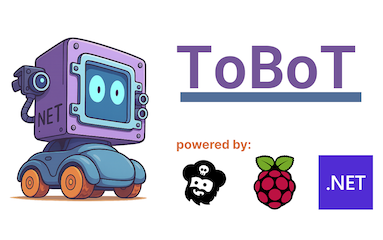
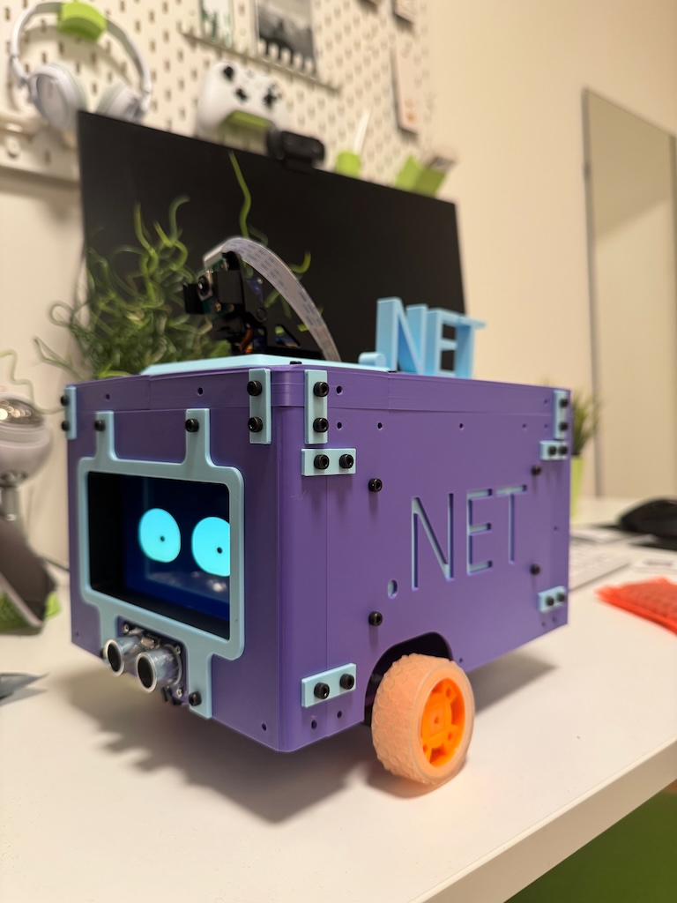
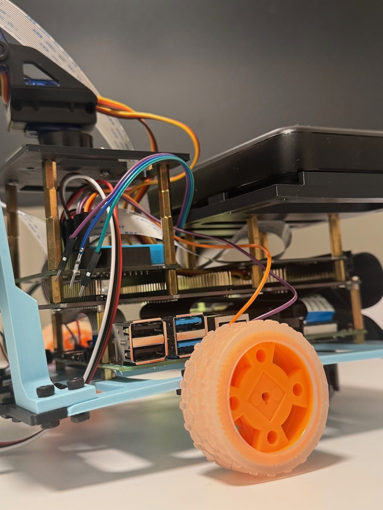
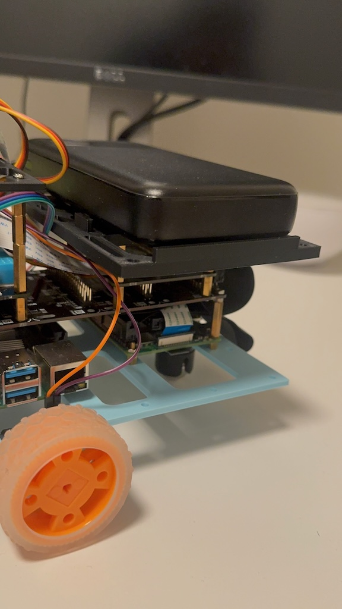
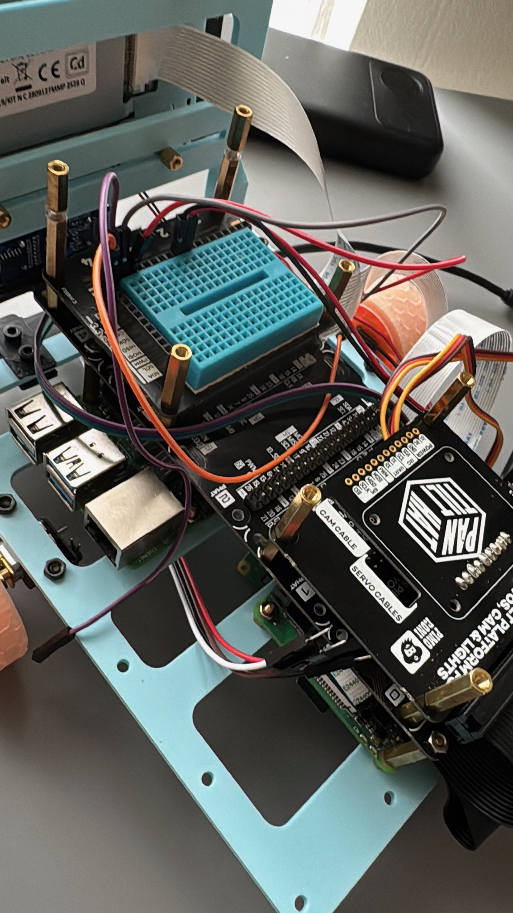
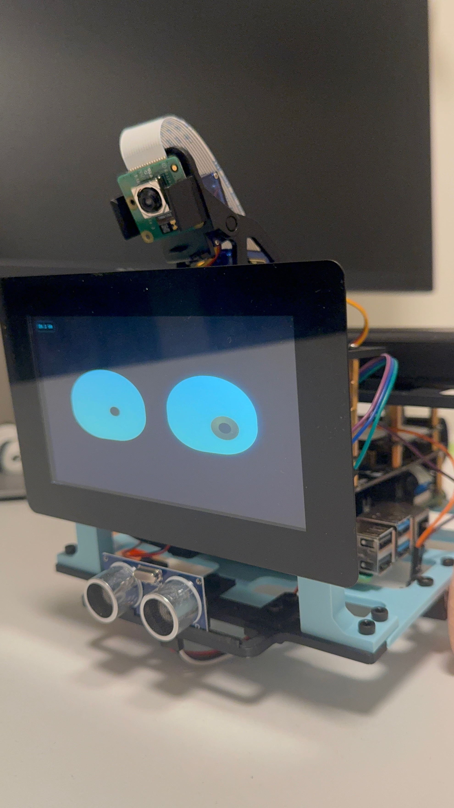
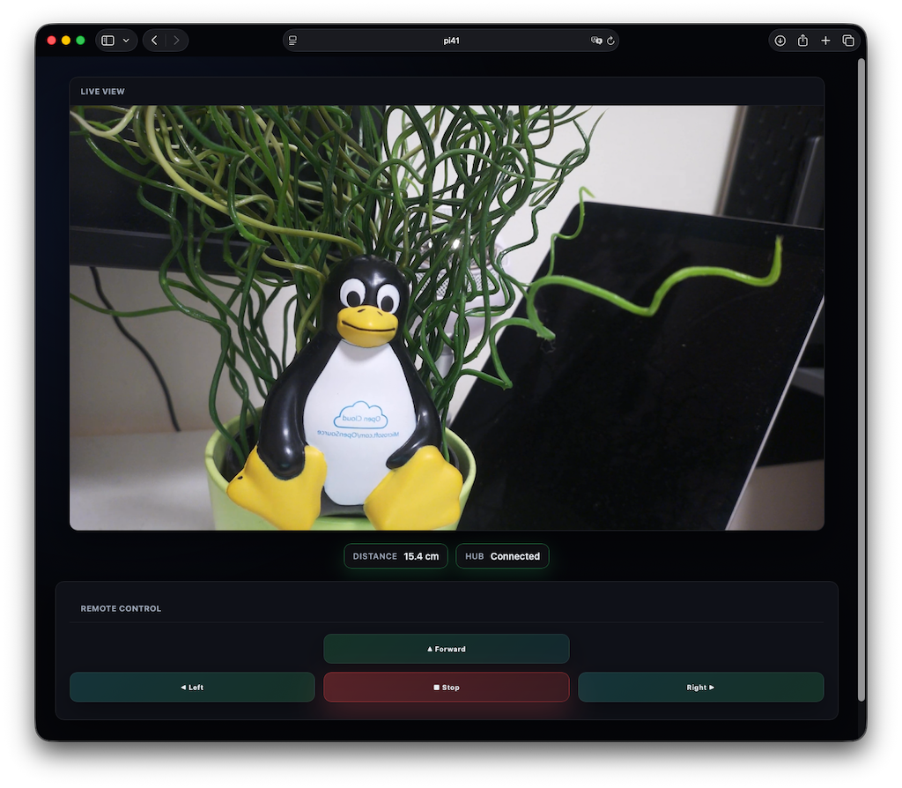
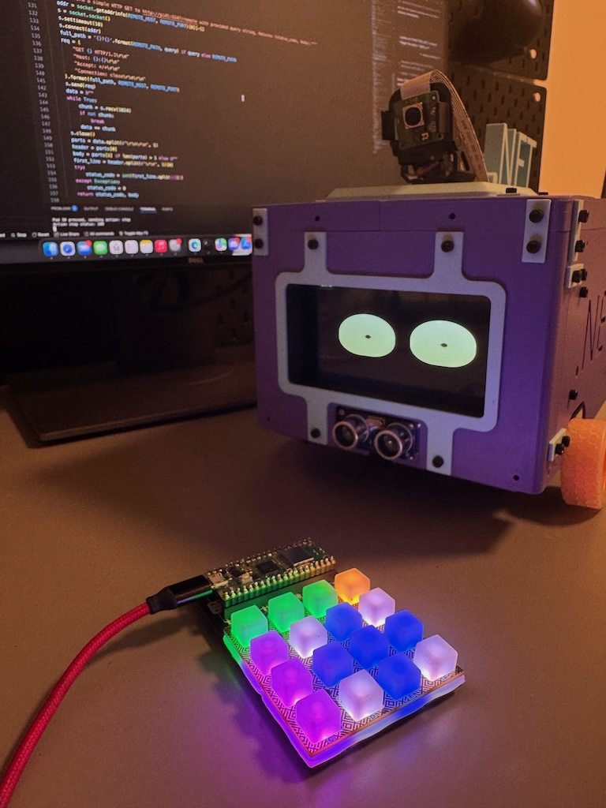
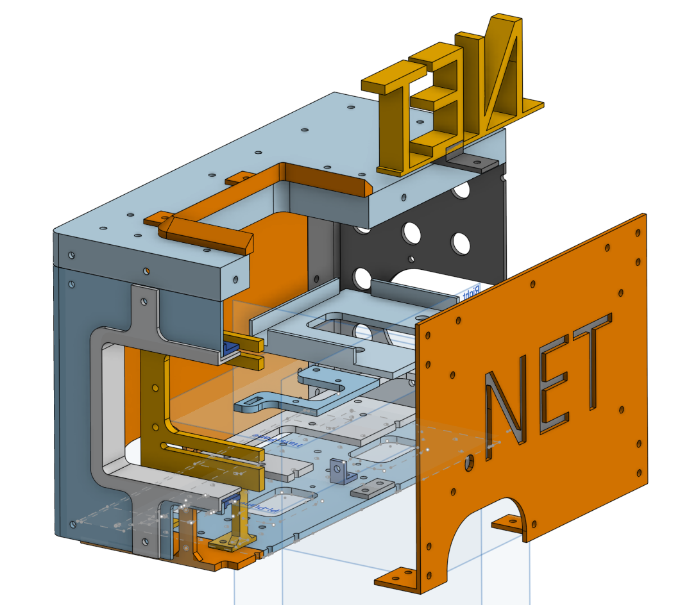
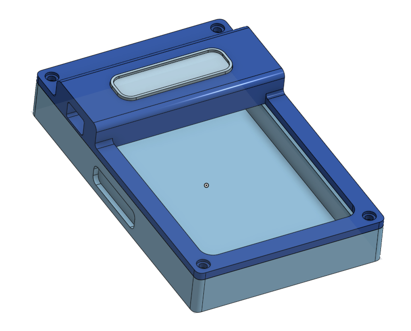

# 🤖 Tobot - Build a Robot with .NET

> **A hands-on .NET robotics playground** for Raspberry Pi sensors, motor control, and remote interfaces.

[](https://dotnet.microsoft.com/)
[](https://docs.microsoft.com/en-us/dotnet/csharp/)
[](https://www.raspberrypi.org/)
[](LICENSE)
[](https://github.com/tscholze/dotnet-iot-raspberrypi-tobot/actions/workflows/ci.yml)

> [!IMPORTANT]
> **Looking for a finished version?** Use the git tag
> [`v2`](https://github.com/tscholze/dotnet-iot-raspberrypi-tobot/releases/tag/v2)
> or the related release on GitHub. The `main` branch contains ongoing work for
> future versions of Tobot and may be incomplete or change at any time.
> The Explorer HAT demo, GTK desktop app, and Pan-Tilt HAT implementation are available in the v2 release.

---

## What is Tobot?

Tobot is a personal robotics project for exploring what C# and .NET can do on a Raspberry Pi. Start with a real HC-SR04 distance sensor, see its readings in a web interface or CLI, and add motor control with a compatible PCA9685 Motor HAT when you are ready.

> **Architecture note:** This branch contains the **v4 architecture**, a rewrite
> that differs from v2 and v3: one `Tobot.Host` app on the Pi owns the hardware and
> exposes a REST API plus a SignalR telemetry hub, and the Razor UI, CLI, MAUI app
> and remote firmware are all clients of it. Statements below that say "in v2" or
> "in v3" describe the older architectures; use the `v2` tag for the finished v2 release.

> **Tobot v4 direction:** The next major version will favor standard, widely
> supported controls and components (such as standard servos and motor
> controllers) over specialized add-on HATs like the Pimoroni Pan-Tilt HAT.
> The Pan-Tilt HAT driver and its dependent demos have been removed from this
> project as part of that transition.

The `Tobot.Host` application brings the hardware and interface together on the Pi. Other devices can use its REST API, follow live updates over SignalR, or open the Blazor web interface.

### ✨ Why Tobot?

- **⚡ Modern .NET** - Build with C# 13 and .NET 10 on Raspberry Pi
- **📡 Real hardware** - Read distance from an HC-SR04 ultrasonic sensor
- **🚗 Optional motor control** - Drive DC or stepper motors with a compatible PCA9685 Motor HAT
- **🌐 One host, many clients** - Use the web UI, CLI, MAUI app, or Pico W remote
- **🎓 Built for learning** - Explore robotics and software in an evolving hobby project

---

## How it looks

### Tobot
#### v3
<div align="center" style="display:flex; gap:12px; justify-content:center; flex-wrap:wrap;">
    
</div>

#### v2
<div align="center" style="display:flex; gap:12px; justify-content:center; flex-wrap:wrap;">
    
    
    
</div>

#### v1
<div align="center" style="display:flex; gap:12px; justify-content:center; flex-wrap:wrap;">
    
    
</div>

### Tobot.Web (v3; now `Tobot.Host`)
<div align="center" style="display:flex; gap:12px; justify-content:center; flex-wrap:wrap;">
    
</div>

### Tobo.PicoRemote
<div align="center" style="display:flex; gap:12px; justify-content:center; flex-wrap:wrap;">
    
</div>

### CAD constructions
<div align="center" style="display:flex; gap:12px; justify-content:center; flex-wrap:wrap;">
    
    
</div>
---

## What Tobot is built around

### 🏗️ Chassis

The repository includes a custom chassis design intended to be accessible to makers with compact 3D printers.

**Key Features:**
- Optimized for compact bed sizes (180×180mm print area)
- Uses standard **PLA filament** - no exotic materials needed
- Compatible with eco-friendly filament from [Recycling Fabrik](https://www.recyclingfabrik.com/) or [BambuLab](https://bambulab.com/)
- Modular design for easy assembly and modifications
- All STL files available in the repository for customization

The chassis is a project design, not a guaranteed bill of materials for the current software setup. The exact current chassis and battery configuration is **TBD**.

---

### 🔧 Hardware

The current hardware implementation is deliberately focused: distance sensing is built around an **HC-SR04 ultrasonic sensor**. Motor control is available through a separate, optional **PCA9685-based Motor HAT**. The current setup does not require a pHAT Stack or Blinkt.

| Component | Role | Status |
| --- | --- | --- |
| Raspberry Pi with GPIO and I2C | Runs `Tobot.Host` and connects to the hardware | Required |
| HC-SR04 ultrasonic sensor | Provides distance readings through `Tobot.Device` | Implemented; default trigger and echo pins are GPIO 12 and 22 |
| Compatible PCA9685 Motor HAT | Controls DC or stepper motors | Optional; see the [MotorKit setup guide](src/Tobot.Device/MotorHat/README.md) |
| Motor power supply and wiring | Powers and connects the motors and sensor | Required for motor control; exact build wiring is **TBD** |

The Motor HAT needs a suitable motor power supply; the Pi's I2C connection does not power the motors. For HC-SR04 wiring, protect the Pi's 3.3 V GPIO by level-shifting the sensor's ECHO signal. Detailed wiring diagrams for a complete robot build are **TBD**.

Older hardware demos and architectures are documented in the [`v2` tag](https://github.com/tscholze/dotnet-iot-raspberrypi-tobot/tree/v2).

---

### 💻 Software

The core Tobot platform uses the **modern .NET ecosystem**, with a small MicroPython firmware client for the optional Pico W remote.

**Technology Stack:**

| Layer                       | Technology                 | Purpose                                      |
| --------------------------- | -------------------------- | -------------------------------------------- |
| **Framework**               | .NET 10                    | Modern runtime with C# 13 language features  |
| **Web UI**                  | ASP.NET Core Blazor        | Interactive, real-time web interface         |
| **Mobile / desktop client** | .NET MAUI                  | Android and Mac Catalyst client               |
| **Real-time Communication** | SignalR                    | Server-to-client live telemetry               |
| **Hardware Access**         | .NET IoT bindings          | GPIO and I2C access for supported hardware    |
| **Operating System**        | Raspberry Pi OS (Bookworm) | Official, stock Raspberry Pi distribution    |
| **System Telemetry**        | Tobot.Device (`Pi/`)       | Hostname, Wi‑Fi SSID/IP, temp, load, mem, disk, uptime, freq |

**Why .NET?**
- **Cross-platform**: Runs natively on ARM-based Raspberry Pi
- **Performance**: Compiled code with optimized memory management
- **Tooling**: World-class IDEs (Visual Studio, VS Code) with IntelliSense and debugging
- **Modern Language**: C# 13 with pattern matching, async/await, and strong typing
- **Ecosystem**: NuGet package ecosystem with thousands of libraries
- **Long-term Support**: Microsoft's commitment to .NET on IoT

**Architecture Highlights:**
- **Unified Controller**: `TobotController` abstracts all hardware complexity
- **Package-based Organization**: Clean separation of concerns by functionality
- **XML Documentation**: Every public API is fully documented
- **Async/Await**: Non-blocking operations for responsive control
- **Resource Safety**: Proper disposal patterns throughout

No custom kernel modules, no modified OS images - just standard Raspberry Pi OS with .NET SDK installed. This makes Tobot easy to set up, maintain, and extend.

---

## ⚡ Hardware API Example

```csharp
using Tobot.Device;

// Initialize the distance sensor controller
using var controller = new TobotController();

if (controller.TryReadDistance(out double distanceCm))
{
    Console.WriteLine($"Distance: {distanceCm:F1} cm");
}
```

---

## 🎯 What's Included?

### 📦 Tobot.Device Library

A hardware library with:

| Package | Components | Description |
| --- | --- | --- |
| **📐 Distance** | `HcSr04Sensor`, `TobotController` | HC-SR04 distance readings and monitoring |
| **🚗 Motor HAT** | `MotorKit`, `DCMotor`, `StepperMotor` | PCA9685-based motor control |

#### 📐 HC-SR04 Ultrasonic Distance

`TobotController` wraps the HC-SR04 ultrasonic range finder via the `HcSr04Sensor` manager and provides basic distance measurement.

**Basic Distance Reading:**
- Call `TryReadDistance` for non-throwing reads or `ReadDistance` to enforce a measurement
- Adjustable sample count for noise reduction (defaults to 5 readings)
- Shares the controller's GPIO instance so trigger/echo pins are automatically managed

### 🎮 ToBot CLI

The `Tobot.Cli` project (`src/Tobot.Cli`) is a REST/SignalR client of `Tobot.Host`. It supports `distance`, `status`, `watch`, `help` and `exit`; set `TOBOT_URL` (default `http://localhost:5247`).
The previous Explorer HAT demo is available in the [v2 release](https://github.com/tscholze/dotnet-iot-raspberrypi-tobot/releases/tag/v2).

### 🌐 Tobot.Host Application

A modern web-based control interface featuring:

- **REST API** - `GET /api/distance`, `GET /api/status`, `POST /api/drive` (`{"left":50,"right":50}`, -100..100), `POST /api/drive/stop`, `GET /remote?action=` for firmware remotes (no authentication yet; Microsoft Account SSO is planned). Camera URL and remote speed are configured under `Tobot` in `appsettings.json`
- **SignalR Telemetry** - Server-to-client push on `/hubs/telemetry`
- **Live Updates** - Receive real-time distance and Pi status updates
- **Interactive UI** - Clean, responsive Blazor interface
- **Multi-Device Support** - Access from phones, tablets, or computers

#### Available Pages

**Bot** (`/bot`)
- Animated reactive eyes with mood states
- Distance sensor visualization
- Responsive mood changes based on sensor data

### 📱 MAUI Client

The current `Tobot.Maui` project is a client of `Tobot.Host`, not a direct hardware driver. It targets Android and Mac Catalyst (on macOS); building it requires the MAUI workload. The older GTK example is available in the [`v2` tag](https://github.com/tscholze/dotnet-iot-raspberrypi-tobot/tree/v2).

### 🎮 Tobot.PicoRemote Application (`firmware/Tobot.PicoRemote`)

A wireless remote control firmware for the **Raspberry Pi Pico W** with **Pimoroni PicoKeypad**, enabling control of Tobot from a handheld 16-button wireless controller.

Features:
- **16-Key RGB Keypad** - Intuitive button layout with visual LED feedback
- **WiFi Connectivity** - Calls `GET /remote?action=forward|backwards|left|right|stop|ping` on `Tobot.Host` (speed: `Tobot:RemoteSpeed` in `appsettings.json`); copy `secret.example.py` to `secret.py` and fill in your Wi-Fi credentials
- **Status Indicators** - Real-time LED display of boot, WiFi, and remote endpoint status
- **Controller Layout**:
  - Directional controls: Up (forward), Down (backward), Left, Right
  - Center Stop button
  - Special function keys for Light On/Off and additional controls
- **Configuration** - Easily customizable host, port, and key mappings

Requirements:
- Raspberry Pi Pico W (WiFi capable)
- Pimoroni PicoKeypad (16 RGB backlit keys)
- MicroPython with `picokeypad` library
- WiFi credentials in `secret.py` (SSID and PASSWORD)
- Network access to Tobot.Host application

Usage:
```bash
# Configure WiFi credentials
echo "SSID = 'your-wifi-name'" > firmware/Tobot.PicoRemote/secret.py
echo "PASSWORD = 'your-wifi-password'" >> firmware/Tobot.PicoRemote/secret.py

# Upload remote-control.py to Pico W via Thonny or similar
# The firmware will auto-start and connect to your Tobot.Host instance
```

Note: Update `REMOTE_HOST` and `REMOTE_PORT` in `remote-control.py` to match your Tobot.Host deployment.

---

### 🖥️ Pi System Info

The `Tobot.Device.Pi` namespace (in `Tobot.Device`) exposes Raspberry Pi telemetry via `PiSystemInfo` and publishes periodic `PiStatusSnapshot` updates.

Highlights:
- Hostname and Wi‑Fi details: SSID + primary Wi‑Fi IPv4
- CPU metrics: temperature (°C rounded) and frequency (MHz)
- Load averages: 1/5/15 minutes
- Memory: total/available (kB) with easy MB display in demo
- Disk: total/free in GiB (root mount)
- Uptime: seconds (rendered as days/hours/minutes in demo)
- Events: `TemperatureChanged` (thresholded) and `StatusChanged` (full snapshot)

Quick usage:

```csharp
using Tobot.Device.Pi;

// One-shot reads
Console.WriteLine($"Host: {PiSystemInfo.GetHostName()}");
Console.WriteLine($"Wi‑Fi SSID: {PiSystemInfo.GetWifiSsid() ?? "(not connected)"}");
var wifiIps = PiSystemInfo.GetIpAddresses(includeIPv6: false, wifiOnly: true);
Console.WriteLine($"Wi‑Fi IP: {(wifiIps.Count > 0 ? wifiIps[0].ToString() : "(none)")}");

// Subscribe to periodic snapshots (includes load/mem/disk/uptime/freq)
PiSystemInfo.StatusChanged += (s, snap) =>
{
    Console.WriteLine($"Temp {snap.CpuTempC}°C | Load {snap.LoadAvg1Minute:F2}/{snap.LoadAvg5Minutes:F2}/{snap.LoadAvg15Minutes:F2} | Free {snap.DiskFreeGiB:F1} GiB");
};
PiSystemInfo.StartTemperaturePublishing();
```

---

## 🚀 Quick Start

### Prerequisites

- Raspberry Pi (any model with 40-pin GPIO)
- PCA9685 Motor HAT (optional, for motor control)
- HC-SR04 ultrasonic sensor
- .NET 10 SDK

### Installation

```bash
# Clone the repository
git clone https://github.com/tscholze/dotnet-iot-raspberrypi-tobot.git
cd dotnet-iot-raspberrypi-tobot

# Build the solution and run the tests
dotnet build
dotnet test --solution Tobot.slnx

# Run the host (on the Pi), then the CLI (anywhere)
dotnet run --project src/Tobot.Host
dotnet run --project src/Tobot.Cli
```

---

## 🧰 Scripts

All helper scripts live in `scripts/` at the project root.

- `scripts/run-tobot-web-kiosk.sh`: Starts the `Tobot.Host` Blazor app and opens it in Firefox kiosk mode on the Raspberry Pi at `http://localhost:5247/bot`.
- `scripts/add-to-autostart.sh`: Installs a user systemd service (`tobot-web-kiosk.service`) that runs the kiosk script automatically after the graphical session starts.
- `scripts/remove-from-autostart.sh`: Disables and removes the autostart user service.

Usage:

```bash
chmod +x scripts/run-tobot-web-kiosk.sh
chmod +x scripts/add-to-autostart.sh
chmod +x scripts/remove-from-autostart.sh

# Run once (non-autostart)
./scripts/run-tobot-web-kiosk.sh

# Enable autostart (user service)
./scripts/add-to-autostart.sh

# Remove autostart
./scripts/remove-from-autostart.sh

# Check status
systemctl --user status tobot-web-kiosk.service --no-pager

# Optional: keep user services running at boot without login
sudo loginctl enable-linger $USER
```

Notes:
- Requires `firefox` (or `firefox-esr`) installed on the Raspberry Pi.
- Binds the web app to `0.0.0.0:5247` so it’s reachable on your LAN.
- Adjust the script if you prefer Chromium (`chromium-browser --kiosk`).
- The autostart unit runs after `graphical-session.target` and sets `DISPLAY=:0`. If `systemctl --user` is unavailable in your session, run from the desktop session or enable linger as shown above.

---

## 🏛️ Architecture

Tobot follows a clean, modular architecture:

```
Tobot/
├── src/
│   ├── Tobot.Shared/      Models, API contract (ITobotApi), route + hub event constants (everywhere)
│   ├── Tobot.Device/      Pi only: HcSr04/, MotorHat/, Pi/ (PiSystemInfo), TobotController
│   ├── Tobot.Host/        Pi only: REST endpoints, SignalR TelemetryHub, background broadcasters, Blazor UI
│   ├── Tobot.Client/      Typed REST + SignalR client (CLI, MAUI)
│   ├── Tobot.Cli/         Console client (`tobot`)
│   └── Tobot.Maui/        Cross-platform client (Android + Mac Catalyst on macOS; needs MAUI workload; excluded from default build)
├── tests/Tobot.Tests/     Hardware-free unit tests (xUnit v3, Microsoft.Testing.Platform)
├── firmware/
│   └── Tobot.PicoRemote/  Pico W MicroPython remote (listed in the solution, not compiled)
└── scripts/               Pi autostart and kiosk scripts
```

Dependencies: `Host` -> `Device`, `Shared`; `Cli`/`Maui` -> `Client` -> `Shared`. Clients never reference hardware code.

### Key Design Principles

- Context-Related Packaging: Group by functionality for clarity
- Self-Contained Packages: Avoid cross-package dependencies
- Clean APIs: Intuitive, discoverable interfaces
- Comprehensive Docs: XML documentation across the codebase
- Resource Safety: Consistent `IDisposable` usage and cleanup

---

## 🎯 Features & Capabilities

### 🚗 PCA9685 Motor HAT

The standalone `MotorKit` driver controls a compatible PCA9685 Motor HAT:

```csharp
using Tobot.Device.MotorHat;

using var kit = new MotorKit();
kit.Motor1.Forward(0.6);
// Stop() disables the H-bridge outputs; Brake() actively brakes.
kit.Motor1.Stop();
```

See the [MotorKit setup guide and DC/stepper examples](src/Tobot.Device/MotorHat/README.md)
for hardware setup, configuration, safe cleanup, and shared-channel details.

### 📐 Ultrasonic Distance (HC-SR04)

Basic distance measurement:
```csharp
if (controller.TryReadDistance(out double distanceCm, samples: 5))
{
    Console.WriteLine($"Distance: {distanceCm:F1} cm");
}
else
{
    Console.WriteLine("Measurement failed");
}
```

---

## 📚 Documentation

| Document                                                                                             | Description            |
| ---------------------------------------------------------------------------------------------------- | ---------------------- |
| [src/Tobot.Cli/README.md](src/Tobot.Cli/README.md)                                                                   | CLI overview           |
| [Tobot.Device/MotorHat/README.md](src/Tobot.Device/MotorHat/README.md) | Motor HAT setup and API reference |

---

## 📖 Learning Resources

### Code Examples

The previous Explorer HAT demo application is available in the [v2 release](https://github.com/tscholze/dotnet-iot-raspberrypi-tobot/releases/tag/v2).

---

## 🔧 Hardware Specifications

For PCA9685 Motor HAT wiring, configuration, and pin details, see the
[MotorKit guide](src/Tobot.Device/MotorHat/README.md).

## ⚙️ Advanced Usage

### Distance Monitoring

```csharp
using var controller = new TobotController();

using var subscription = controller.ObserveDistance().Subscribe(distanceCm =>
{
    Console.WriteLine($"Distance changed: {distanceCm:F1} cm");
});
```

### Async/Await Support

```csharp
public async Task MonitorSensorsAsync(CancellationToken ct)
{
    using var controller = new TobotController();
	
    while (!ct.IsCancellationRequested)
    {
        if (controller.TryReadDistance(out double distanceCm))
        {
            Console.WriteLine($"Distance: {distanceCm:F1} cm");
        }
		
        await Task.Delay(100, ct);
    }
}
```

---

## 🤝 Contributing

This project welcome contributions! Whether it's:

- 🐛 Bug reports
- 💡 Feature requests  
- 📝 Documentation improvements
- 💻 Code examples
- 🔧 Driver enhancements

Please note, that I am developing this project for my self and there is no intend to make it a "market product" in sense of warranty, liability, etc.

For more, please see [CONTRIBUTING.md](CONTRIBUTING.md) for guidelines.

---

## ✅ CI / Pre-Merge Checks

Every pull request and push to `main` runs through an automated pipeline on a free GitHub-hosted `ubuntu-latest` runner.

| Step | What it catches |
|---|---|
| **Restore** | Missing or broken NuGet packages |
| **Build (Release)** | Compile errors across all projects |

The workflow is defined in [`.github/workflows/ci.yml`](.github/workflows/ci.yml).

### Known limitations

- **Hardware tests are not possible in CI** — GPIO and Raspberry Pi hardware require a physical device.
- **Format verification is not yet enabled** — a `.editorconfig` needs to be added first.
- **`TreatWarningsAsErrors` is not yet enabled** — GPIO calls need `[SupportedOSPlatform("linux")]` annotations before this can be safely enforced.

---

## 🗺️ Roadmap

### Current Features
- HC-SR04 distance sensing
- PCA9685 Motor HAT driver
- Interactive CLI starting point
- Comprehensive documentation
- Package-based architecture

### 🔮 Planned Features 
- [X] PWM motor speed control
- [ ] Advanced pattern library
- [ ] Configuration system
- [ ] Logging framework
- [ ] Unit test coverage
- [X] CI/CD pipeline

---

## 💻 Why .NET for Robotics?

### Modern Language Features
- **Pattern Matching** - Clean state machine logic
- **Async/Await** - Non-blocking sensor reading
- **LINQ** - Elegant data processing
- **Strong Typing** - Catch errors at compile time

### Excellent Tooling
- **Visual Studio / VS Code** - World-class IDEs
- **IntelliSense** - Discover APIs as you code
- **Debugging** - Full breakpoint support
- **Package Management** - NuGet ecosystem

### Performance
- **Native ARM** - Optimized for Raspberry Pi
- **Efficient Memory** - Garbage collection tuned for IoT
- **Low Latency** - Real-time control capable

---

## 🙏 Acknowledgments

- **Adafruit** - For the PCA9685 Motor HAT hardware
- **.NET Team** - For bringing .NET to ARM/IoT devices
- **Open Source Community** - For inspiration and support

---

## 📄 License

This project is licensed under the MIT License - see [LICENSE](LICENSE) file for details.

---

## 🔗 Links

- **Hardware**: [Adafruit Motor HAT](https://www.adafruit.com/product/2348)
- **Documentation**: [.NET IoT Libraries](https://github.com/dotnet/iot)
- **Community**: [Raspberry Pi Forums](https://forums.raspberrypi.com/)
- **Support**: [Open an Issue](https://github.com/tscholze/dotnet-iot-raspberrypi-tobot/issues)

---

## 🚀 Get Started Now!

```bash
git clone https://github.com/tscholze/dotnet-iot-raspberrypi-tobot.git
cd dotnet-iot-raspberrypi-tobot
dotnet run --project src/Tobot.Host
```

**Ready to build something amazing?** The future of robotics is .NET! ???

---

<div align="center">

**Made with ❤️ for makers, educators, and robotics enthusiasts**

[⭐ Star this repo](https://github.com/tscholze/dotnet-iot-raspberrypi-tobot) | [📚 Read the docs](src/Tobot.Cli/README.md)

</div>
